# BitDog Arcade

Nove jogos em um firmware para **BitDogLab com RP2040/Pico W**, usando OLED, joystick, buzzer e matriz RGB 5×5.

**B, à direita: jogar, saltar, atirar e confirmar. A, à esquerda: pausar e voltar.**

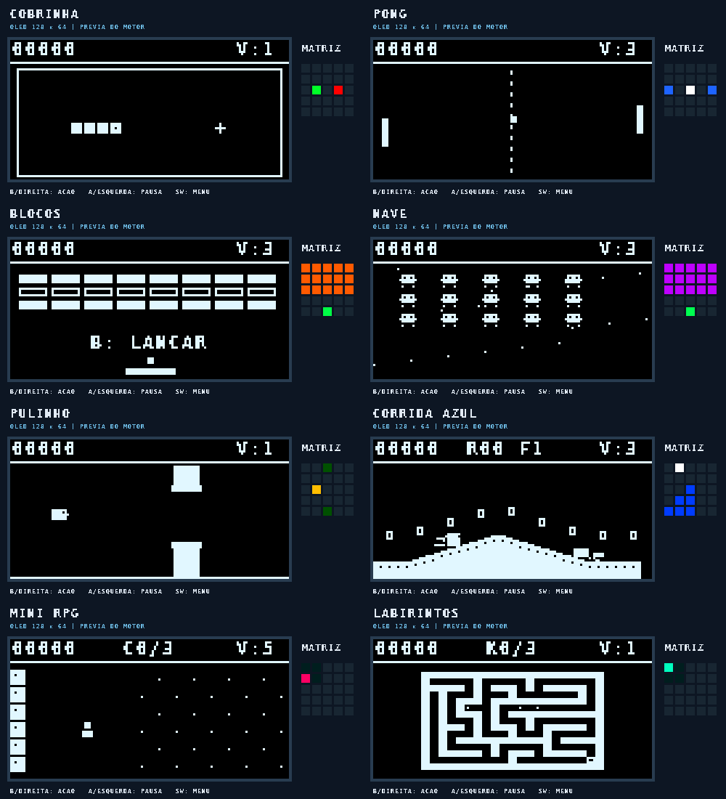

As imagens são cenários demonstrativos renderizados pelo mesmo motor C++ dos jogos, sem suavização dos pixels. Não são fotografias da placa. A matriz mostrada ao lado usa os 25 pixels lógicos produzidos pelo motor.

## Jogos

| Jogo | Ação | Matriz no modo EXTRA |
|---|---|---|
| Cobrinha | Joystick muda a direção; evite paredes e corpo | Cobra e comida |
| Pong | Joystick para cima/baixo controla a raquete | Bola e raquetes |
| Blocos | Joystick move a raquete; **B** lança a bola | Blocos e bola |
| Nave | Joystick move; segure **B** para disparar | Inimigos e jogador |
| Pulinho | Toque **B** para voar entre os canos | Altura e obstáculos |
| Corrida Azul | Joystick acelera/freia; **B** salta; **baixo+B** carrega spin dash | Velocidade, carga e progresso |
| Mini RPG | Joystick anda; **B** ataca ou conversa | Área explorada e posição |
| Labirintos | Ache três chaves; **B** alterna o mapa | Exploração e posição |
| Pokémon Mini | Explore o mato; joystick escolhe golpes; **B** confirma | HP e cores da equipe; HP adversário |

### Corrida Azul

A adaptação inspirada em Sonic 2 passa a ter aceleração e inércia, frenagem ao inverter a direção, salto de altura variável, rolagem, **spin dash**, anéis que se espalham ao sofrer dano e podem ser recuperados, dois checkpoints por etapa, molas, inimigos e fundo com paralaxe. Um loop é percorrido com velocidade suficiente. Há três etapas com variações de terreno.

- Segure **B** durante o salto para subir mais; um toque produz um salto menor.
- Em movimento, **baixo** faz o personagem rolar. Parado, segure **baixo**, toque **B** para carregar e solte **baixo** para disparar.
- Com anéis, um impacto os espalha e dá invulnerabilidade temporária. Sem anéis, o impacto custa uma vida. Cair custa uma vida e retorna ao último checkpoint.

É uma adaptação pequena para OLED monocromática, com cenários e pixel art próprios. Não reproduz as fases completas, física integral, chefes, áudio ou modo de dois personagens do jogo comercial.

### Pokémon Mini

Fan game compacto com pixel art desenhada para este projeto: comece com **Pikachu**, procure **Bulbasaur, Squirtle e Pidgey** no mato e forme uma equipe de até quatro espécies.

1. No mapa, mova o joystick. O mato pode iniciar uma batalha.
2. Na batalha, o joystick escolhe **GOLPE / BOLA / POÇÃO / FUGIR**; **B** confirma. Reduzir o HP adversário aumenta a chance de captura. O contador mostra bolas e poções restantes.
3. Fora da batalha, **B** abre a equipe; selecione com cima/baixo e confirme com **B** para trocar o ativo.
4. Ao lado de um professor, **B** cura e reabastece. São os personagens parados próximos à vila inicial e ao sul.
5. Reúna **três espécies na equipe, incluindo o inicial**, e alcance o ginásio marcado **G**, no sudeste. Vença o treinador para concluir.

Batalhas dão XP e podem subir o nível. Tipos alteram o dano; se o ativo desmaiar, outro membro saudável entra. Se todos desmaiarem, a equipe volta curada à vila. Equipe, progresso e inventário ficam em RAM e reiniciam ao sair da partida ou desligar. Não há ROMs, sprites extraídos nem emulação de Game Boy.

Mini RPG mantém a missão dos três cristais e portal. Labirintos gera corredores conectados a cada partida.

<details><summary>Ver cada jogo</summary>

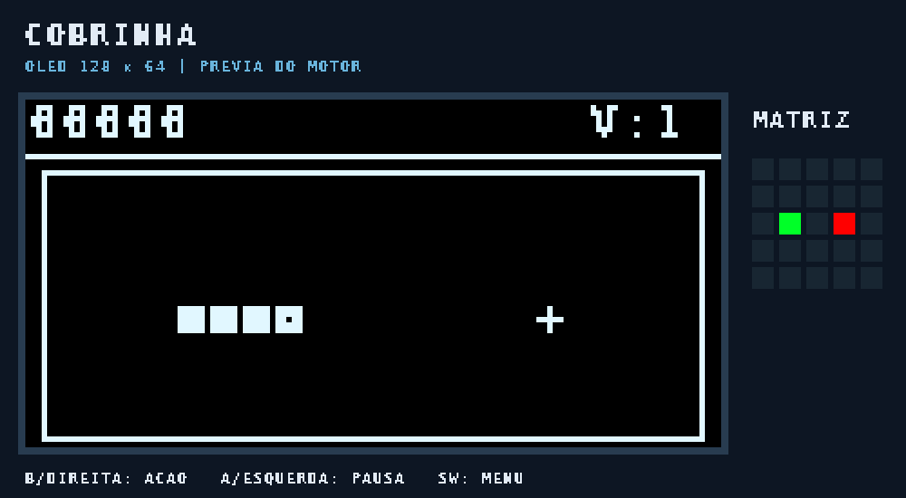
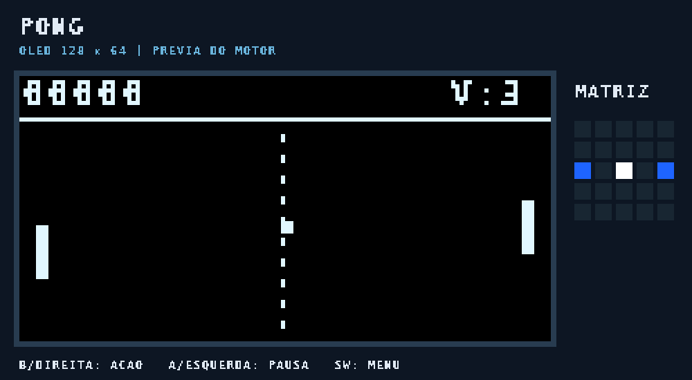
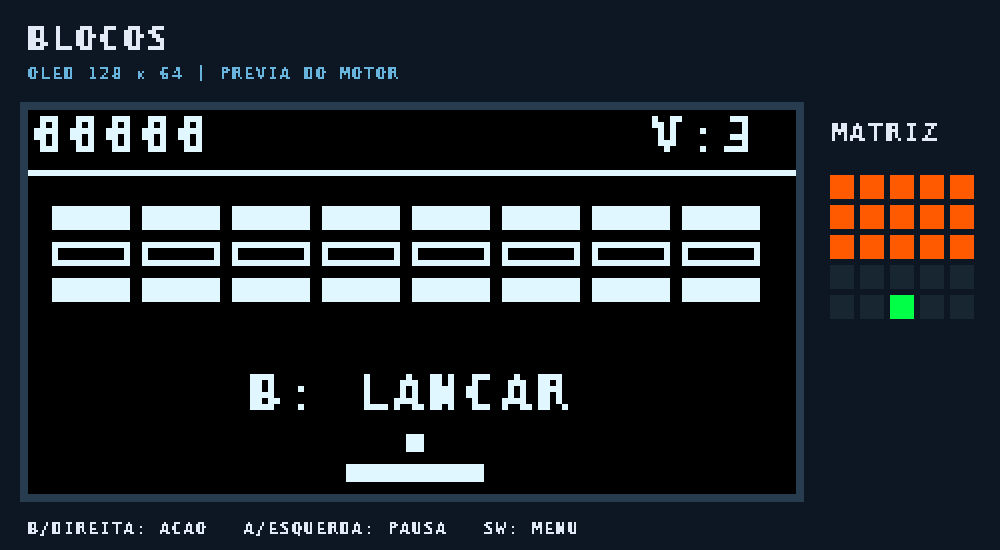
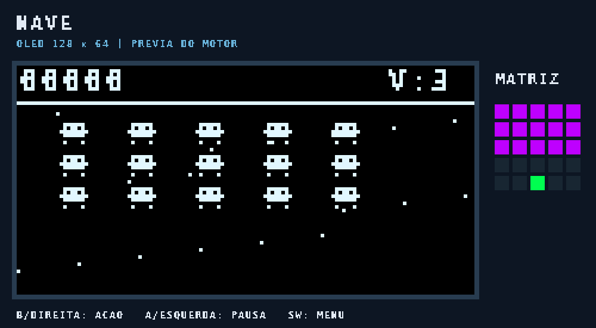
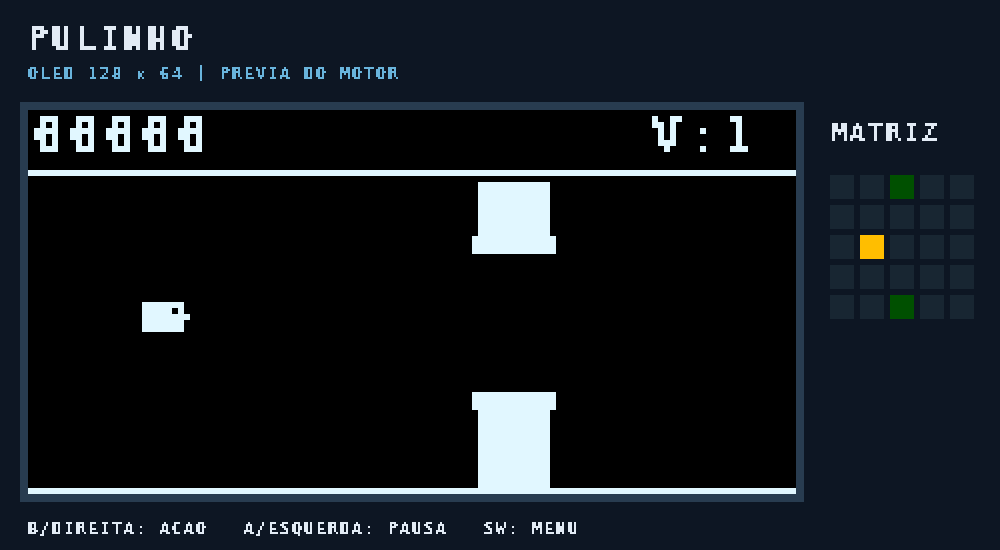
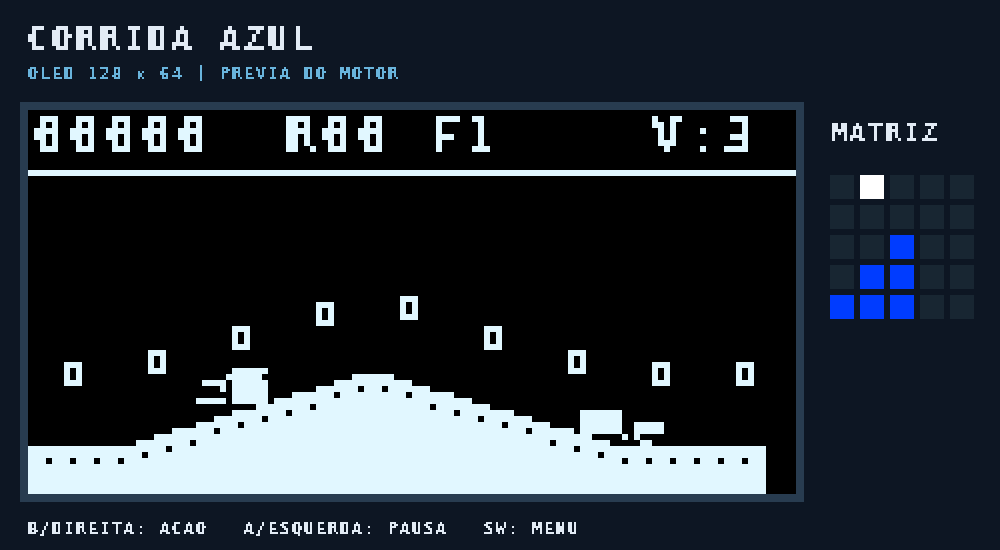
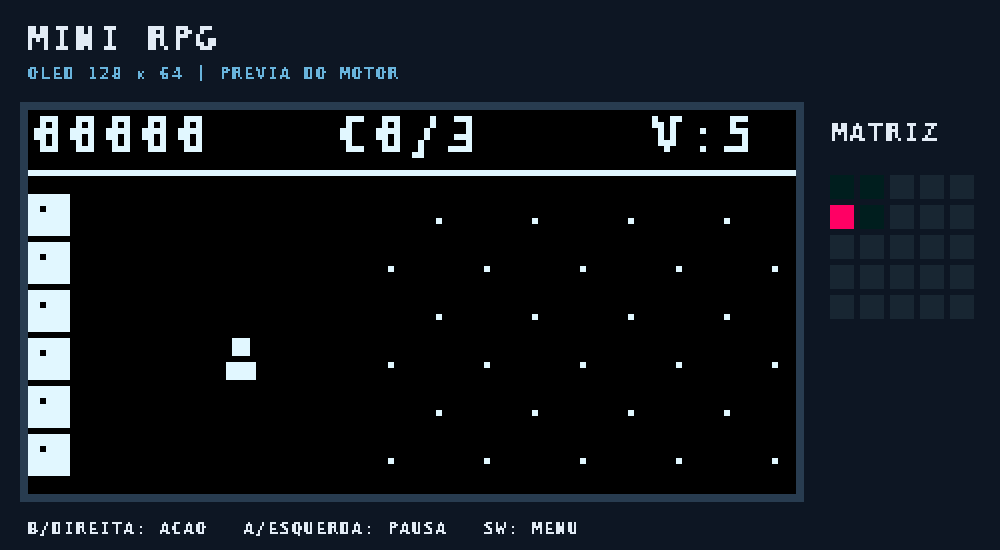
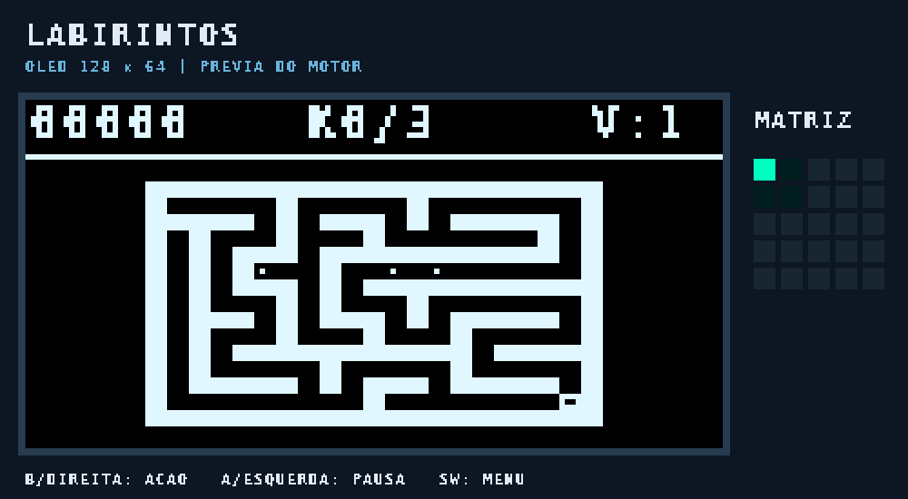
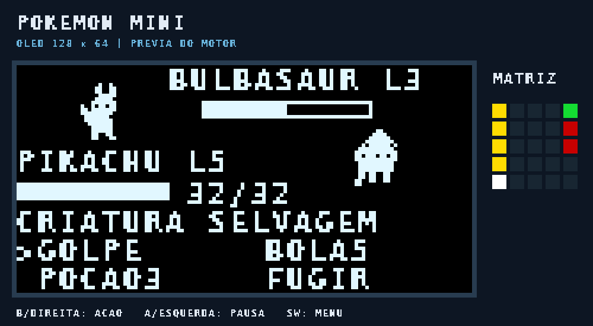

</details>

## Instalar

1. Baixe o [UF2 atual](firmware/bitdoglab_arcade.uf2). Confira no [workflow](https://github.com/Lawtrel/bitdoglab-arcade/actions) se a geração da V3 terminou antes de baixar; o recibo `firmware/audit.json` deve identificar `bitdoglab_arcade_v3` e nove jogos.
2. Segure **BOOTSEL** ao conectar o USB e solte quando aparecer a unidade **RPI-RP2**.
3. Copie o UF2 para essa unidade. Ela desaparece e a placa reinicia.
4. Deixe o joystick solto ao ligar. No menu, selecione com o joystick e pressione **B** duas vezes: instruções e início.

No checkout Windows, `GRAVAR_ARCADE.cmd` confere o hash e a identidade RPI-RP2 antes de copiar. `VERIFICAR_ARCADE.cmd` consulta o firmware por USB. A versão [arcade-v1.uf2](firmware/arcade-v1.uf2) preserva o arcade anterior, que o autor confirmou funcionando na placa; nela as ações ainda ficam no botão esquerdo. `RESTAURAR_ARCADE_V1.cmd` permite voltar a essa versão. A [V2 com oito jogos e ação à direita](firmware/arcade-v2.uf2) também foi preservada: use `RESTAURAR_ARCADE_V2.cmd` para restaurá-la.

## Controles

| Onde | Controle |
|---|---|
| Menu | Joystick escolhe; **B** abre/inicia; **A** abre ajustes |
| Jogo | **B** executa a ação específica; **A** curto pausa/continua |
| Voltar ao menu | Aperte o joystick (SW) ou segure **A** por 0,75 s |
| Fim de jogo | **B** reinicia; **A** volta ao menu |
| Ajustes | Joystick navega; **B** altera; **A** volta |

Nos ajustes você escolhe som, brilho, rotação da matriz e orientação dos eixos. O modo **EXTRA** mostra uma visão complementar do jogo. Em **PONTOS**, a matriz exibe o placar completo um algarismo de cada vez; uma luz lateral indica a posição do algarismo. O OLED mantém o total visível. Recordes e configurações ficam em RAM e reiniciam ao desligar.

## Organização e padrões

O código não depende de um interpretador de ROMs e não aloca objetos de jogo com `new` no loop.

| Responsabilidade | Arquivo | Decisão |
|---|---|---|
| Interface do console | `src/core/app.hpp` | Facade e máquina de estados para menu, pausa, diálogo e partida |
| Catálogo de jogos | `src/core/game_factory.hpp` | Seleção estática de estratégias, sem heap ou RTTI |
| Regras e desenho de cada jogo | `src/games/*.hpp` | Strategy: `reset`, `update`, `draw` e `matrix` por jogo |
| Estado da partida | `src/core/game_session.hpp` | Contexto estático separado da navegação e do hardware |
| Entrada lógica | `src/core/types.hpp` | `InputMapper`: botões físicos viram Action/Pause/Menu |
| OLED, ADC, PIO e buzzer | `src/platform/pico_hardware.hpp` | Adapter entre periféricos e o motor |
| Pixels e texto | `src/ui/framebuffer.hpp` | Framebuffer independente do Pico SDK |
| Inicialização | `src/main.cpp` | Composição e loop do firmware |

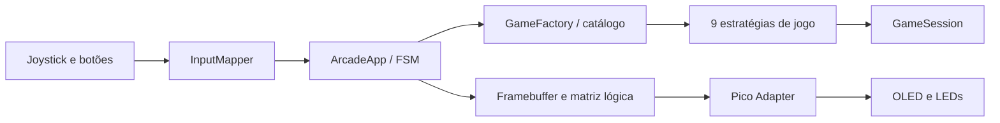

## Validação e builds

O workflow testa o motor com AddressSanitizer e UndefinedBehaviorSanitizer, verifica os botões, pausa, recordes, 100 labirintos conectados a missão do RPG, captura/cura/batalhas de Pokémon, limites dos menus e física da corrida. Também testa a conversão/auditoria UF2, gera as imagens e compila o firmware RP2040 com SDK fixado. Só depois de tudo passar publica imagens e binários gerados.

Cada UF2 é comparado byte a byte com o BIN. `firmware/audit.json` contém os hashes e `firmware/build-info.json` identifica o código e os controles compilados. Compilação, testes no computador e resposta USB são evidências diferentes da verificação física de OLED, matriz e joystick. A V2 foi gravada pelo autor. As mudanças da V3 precisam ser conferidas na placa após a gravação.

A conversão para UF2 usa Python; não executa picotool nem altera proteções do Windows. Não há dependência de pioasm no PC. Wi-Fi e Bluetooth não são utilizados.

Para testar o motor em Linux:

```bash
mkdir -p work
c++ -std=c++17 -O1 -g -fsanitize=address,undefined -Isrc tests/engine_test.cpp -o work/engine-test
./work/engine-test
python -m unittest discover -s tests -p 'test_*.py' -v
```

Para compilar com Pico SDK e GNU Arm Toolchain instalados:

```bash
cmake -S . -B work/build -DPICO_SDK_PATH=/caminho/pico-sdk -DPICO_BOARD=pico_w
cmake --build work/build --parallel
python tools/audit.py work/build
```

No Windows, os scripts procuram ferramentas no PATH ou em `local-settings.json` (arquivo local ignorado pelo Git). A pinagem usada é A5, B6, SW22, joystick ADC26/27, matriz7, buzzer21 e OLED I2C1 14/15, com detecção alternativa em 2/3. A orientação é ajustável no menu.

## Licenças e fontes

Código novo: **MIT**. Pokémon e Sonic são marcas de seus respectivos titulares; este é um projeto de fã independente e não afiliado. A licença MIT do código não concede direitos sobre essas marcas ou personagens. A fonte rasterizada DejaVu e o código PIO de referência conservam suas licenças em `licenses/`.

- [BitDogLab — projeto oficial](https://github.com/BitDogLab/BitDogLab)
- [Pico SDK — hardware APIs](https://www.raspberrypi.com/documentation/pico-sdk/hardware.html)
- [WS2812 — exemplo oficial](https://github.com/raspberrypi/pico-examples/tree/master/pio/ws2812)
